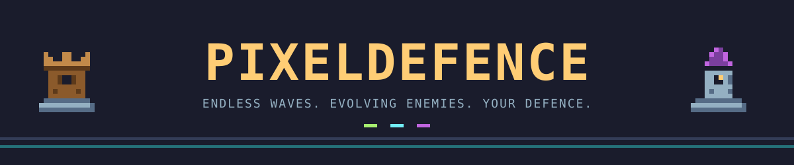
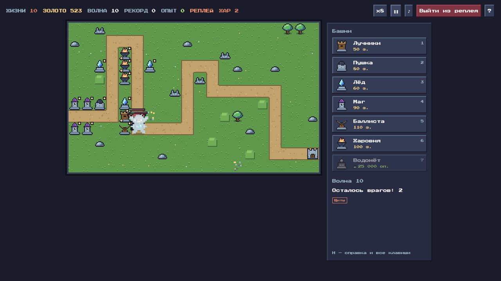

<div align="center">



**Новая карта. Новая оборона. Ещё одна волна.**

Пиксельная tower defense с бесконечными волнами, карточками улучшений и процедурными картами.

[](LICENSE)


[Возможности](#возможности) · [Запуск](#запуск) · [Управление](#управление) · [Устройство проекта](#устройство-проекта)



</div>

Стройте оборону вдоль извилистой дороги, подбирайте улучшения и защищайте замок столько, сколько сможете. Враги становятся сильнее и приобретают новые свойства. Каждая партия — попытка пережить ещё одну волну.

## Возможности

- **Процедурные карты.** Каждая новая партия получает свой маршрут, препятствия и места для строительства.
- **Бесконечные волны.** Боссы, эволюции врагов и модификаторы волн требуют менять состав обороны.
- **Семь типов башен.** Лучники, пушка, лёд, маг, баллиста, жаровня и водомёт — от одиночных выстрелов до молний и контроля толпы.
- **Карточки улучшений.** Башни получают опыт за урон. При повышении уровня выбирайте карту из случайного набора: от прибавок к характеристикам до особых легендарных эффектов. Набор можно перебросить за золото.
- **Прогресс игрока.** Отдельный опыт открывает башни и таланты в Арсенале.
- **Активные способности.** Метеор, стужа и починка замка помогают пережить опасные моменты.
- **Вызовы.** Ежедневный забег и дополнительные условия сложности.
- **Сохранения и реплеи.** Три слота, экспорт и импорт сохранений, запись и воспроизведение партий.
- **Таблица лидеров.** Сервер хранит результаты в SQLite.

Спрайты заданы пиксельными сетками в коде, а звуки создаются через Web Audio API.

## Запуск

Нужны Git и [uv](https://docs.astral.sh/uv/). Сервер использует стандартную библиотеку Python; установка Python-пакетов не требуется.

```sh
git clone https://github.com/extezo/PixelDefence.git
cd PixelDefence
~/.local/bin/uv run --no-project --python 3.12 python serve.py 8000
```

Откройте **[localhost:8000](http://localhost:8000)** и выберите «Новая игра». Если Python 3.12 ещё не установлен, uv загрузит его при первом запуске.

Порт занят? Замените `8000` на `8001` в команде и адресе браузера.

## Управление

- **ЛКМ** — построить или выбрать башню; **Shift + ЛКМ** — строить несколько подряд.
- **1–7** — выбрать тип башни; в окне карточек — выбрать карту по номеру.
- **Пробел** — запустить следующую волну.
- **U / S / T** — повысить ранг, продать башню, изменить приоритет цели.
- **E / R** — открыть выбор улучшения / перебросить открытый набор.
- **Z / X / C** — метеор, стужа, починка.
- **F / P / M** — скорость, пауза, звук.
- **Esc** — отменить действие или открыть меню; **H / F1** — полная справка.

## Сохранения

Сохраняться можно между волнами. Сохранения и профиль находятся в `localStorage` браузера; экспортируйте сохранение строкой, чтобы перенести его на другое устройство. Адрес и порт входят в адрес хранилища: на другом порту сохранения автоматически не появятся.

Сервер создаёт базу лидеров в `data/leaderboard.sqlite` при запуске. База, локальные реплеи и рабочие артефакты исключены из Git.

## Устройство проекта

```text
src/
  game.js          Симуляция, бой и запись действий
  config.js        Башни, враги, волны и параметры баланса
  cards.js         Карточки улучшений и редкости
  map.js           Генерация карты по сиду
  render.js        Отрисовка на Canvas
  sprite-data.js   Пиксельные рисунки
  sprites.js       Сборка спрайтов
  ui.js            Меню, Арсенал, справка и управление
  save.js          Профиль, слоты и реплеи
  audio.js         Звуки через Web Audio API
  rng.js           Генератор случайных чисел
  api.js           Обращения к серверу
  main.js          Запуск и игровой цикл
serve.py           HTTP-сервер и API таблицы лидеров
```

## Лицензия

[MIT](LICENSE) — код можно использовать, изменять и распространять с сохранением уведомления об авторстве и текста лицензии.

